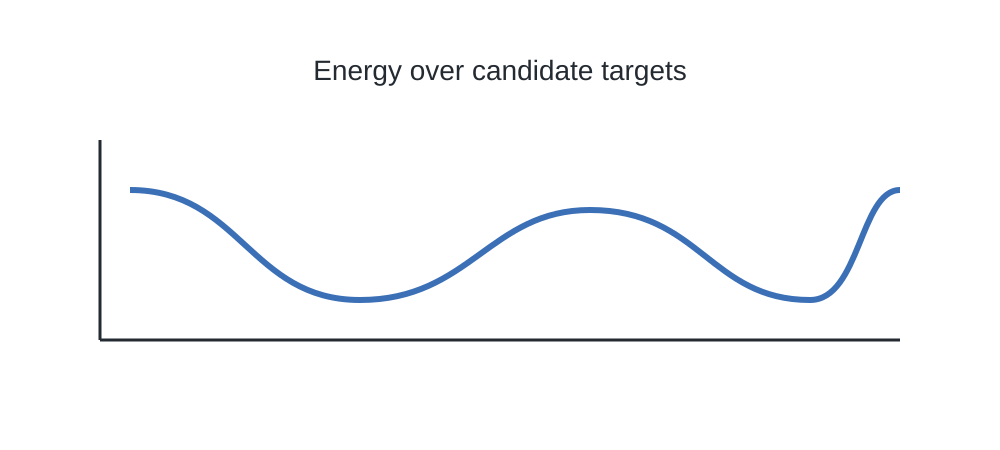
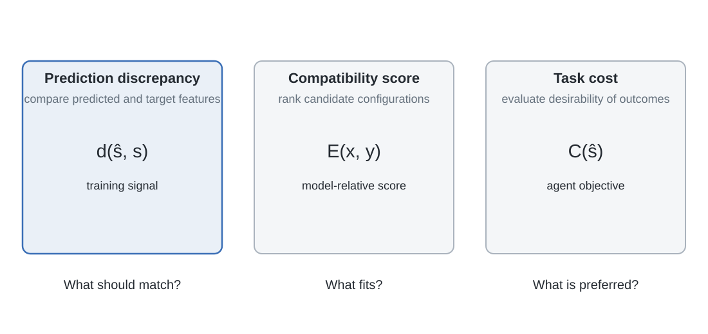

# 1. Compatibility, energy and prediction

A predictive model can estimate an observation, represent a distribution over possible outcomes, or assign a score to a candidate configuration. These descriptions are related, but they are not interchangeable. A joint-embedding predictive architecture does not try to reproduce every detail of an observation. It learns a representation in which a selected target is compatible with the information available in a context.

The most useful starting point is therefore not an encoder architecture. It is the notion of **compatibility**.

## 1.1 A score over candidate targets

Let \(x\) denote information available to a model and \(y\) a candidate target. A model can assign a scalar score

\[
E_\theta(x,y)\in\mathbb R.
\]

Adopt the convention that lower values indicate greater compatibility. Given \(x\), an inference procedure can select a target by solving

\[
\widehat y(x)=\arg\min_{y\in\mathcal Y}E_\theta(x,y).
\]

This is a ranking or optimization rule. It identifies which candidate the model prefers, but it does not specify a probability for that candidate.

A probability density can be defined from an energy by choosing a Gibbs distribution,

\[
p_\theta(y\mid x)
=
\frac{\exp[-E_\theta(x,y)]}{Z_\theta(x)},
\qquad
Z_\theta(x)
=
\int_{\mathcal Y}\exp[-E_\theta(x,y')]\,d\nu(y'),
\]

where \(\nu\) is a specified base measure on the target space. The normalizer \(Z_\theta(x)\), called the partition function, makes the density integrate to one. For a high-dimensional continuous target, computing this integral can be intractable. An energy-based model may therefore use its score directly for ranking or optimization without evaluating a normalized density.

The distinction matters in representation learning. A feature discrepancy can be used as a training loss or compatibility score without defining a calibrated distribution over future observations. A planner can minimize a scalar objective without that objective being a negative log probability. Probability requires a normalization convention and a base measure; optimization requires a scalar criterion and a search domain.

## 1.2 Introducing a latent configuration

A context and target may be compatible for several different reasons. There may be hidden factors, alternative explanations or multiple plausible completions. Introduce a latent variable \(z\) to represent a configuration that is not directly observed:

\[
E_\theta(x,y,z).
\]

There are at least two ways to eliminate the latent variable from this expression. The first is to select the lowest-energy configuration,

\[
F_{\min}(x,y)=\inf_z E_\theta(x,y,z).
\]

This asks whether there exists a latent configuration that makes the pair compatible. It is a minimization over \(z\).

The second is to aggregate over latent configurations,

\[
F_{\mathrm{marg}}(x,y)
=
-\log\int_{\mathcal Z}
\exp[-E_\theta(x,y,z)]\,d\nu(z).
\]

This is a negative log marginal score, up to any normalization terms needed to define the relevant conditional distribution. It combines contributions from all latent configurations rather than retaining only the minimum. If many configurations have similar energy, their combined volume can matter. The minimum-energy and marginal constructions therefore need not rank two candidate targets in the same way.

A latent variable is useful when context alone does not determine one target. A video prefix, for example, may be compatible with several continuations. Different values of \(z\) can select different continuations without requiring the model to average them into one deterministic prediction.

The latent also creates a shortcut. If it has enough capacity to encode the target representation itself, the predictor can ignore the context and transmit the answer through \(z\). The model can then achieve low energy without learning a relation between context and target. The latent must be constrained by its dimension, distribution, inference mechanism or another design choice. The exact constraint determines how many alternatives can be represented and how information is divided between context and latent state.

LeCun's JEPA formulation treats this restriction as a central design requirement: the latent should account for uncertainty that cannot be explained by context, not provide an unrestricted channel for copying the target. This is a conceptual requirement in the position paper, not a claim that it defines one universal mutual-information penalty. (LeCun, 2022)

## 1.3 Joint-embedding prediction

A joint-embedding predictive architecture moves the comparison from observation space to a learned representation space.

Let

\[
s_x=f_\theta(x),
\qquad
s_y=f_{\bar\theta}(y)
\]

be representations of the context and target. A predictor maps the context representation, and possibly a query \(q\), to a target representation:

\[
\widehat s_y=g_\phi(s_x,q).
\]

The query specifies which target is requested. In an image model it may identify spatial positions. In a video model it may identify spatiotemporal positions. In an action-conditioned model it must also include the action or control sequence whose consequence is being predicted.

A feature-space compatibility score is

\[
E_{\theta,\bar\theta,\phi}(x,y,q)
=
d\!\left(
g_\phi(f_\theta(x),q),
f_{\bar\theta}(y)
\right),
\]

where \(d\) measures the discrepancy between predicted and target features. For squared Euclidean distance,

\[
d(u,v)=\|u-v\|_2^2.
\]

Training lowers this discrepancy for context-target-query triples sampled from the data distribution. The target representation determines which discrepancies count. A difference removed by \(f_{\bar\theta}\) contributes little or nothing to the objective; a difference retained by the target encoder remains visible to the loss.

This is the essential change from pixel reconstruction. A pixel-level objective treats discrepancies in the observation as the quantities to explain. A latent prediction objective treats discrepancies in a learned representation as the quantities to explain. Neither choice is universally correct. Fine contact geometry or precise texture may require detailed observation-level information. Object identity, spatial layout or motion may be represented more compactly. Feature prediction changes what is supervised; it does not establish in advance that the representation is sufficient for an agent.

A latent vector is not semantic merely because it is internal. Its invariances are determined by the data, target encoder, mask distribution, temporal sampling, architecture and objective. The representation is a modelling choice. Its usefulness must be evaluated against the distinctions required by downstream predictions and decisions.

## 1.4 Invariance and alternative futures are different operations

A context need not determine a unique target. There are two conceptually different ways to handle multiple outcomes.

The first is **invariance in the target representation**. Suppose observations \(y_1,\ldots,y_m\) differ in details that are irrelevant to the task. If the target encoder maps them to the same representation,

\[
f_{\bar\theta}(y_1)
=
\cdots
=
f_{\bar\theta}(y_m),
\]

then the objective treats them as equivalent targets. A predictor can match that shared representation without choosing among the observation-level differences.

This is appropriate only when those differences are genuinely irrelevant. If the encoder removes object position, contact state or gripper aperture when the task depends on those variables, the invariance is destructive. The training objective has no direct reason to recover information that the target representation has removed.

The second operation is a **latent variable that selects among alternatives**. For example,

\[
\widehat s_y=g_\phi(f_\theta(x),z).
\]

For a fixed context \(x\), different values of \(z\) can produce different predicted representations. The latent preserves distinctions between possible outcomes but allows the model to select among them. A vehicle approaching a fork may turn left or right. The two futures remain different, but the current image does not determine which one will occur.

These mechanisms are not interchangeable. Invariance says that two outcomes should count as the same for the task. A latent variable says that the outcomes remain different, but the available context does not determine which one should be predicted. The first removes a distinction; the second represents an unresolved choice.

## 1.5 The latent must not become a copy of the answer

Suppose the latent \(z\) can carry a vector with the same information as the target representation \(s_y\), and the predictor is expressive enough to ignore the context and output \(z\). It can choose \(z=s_y\), giving

\[
d\!\left(g_\phi(s_x,z),s_y\right)=0
\]

without learning how the context relates to the target.

The objective would be minimized for the wrong reason. The predictor would not be estimating the target from context; the latent would be transmitting the target directly.

A useful architecture must therefore decide which information is permitted to enter the latent variable and how that information is selected. Its capacity may be limited, its distribution may be constrained, or its values may be inferred through a separate mechanism. A model that needs several plausible futures must preserve enough capacity to represent them, while preventing the latent from making every target trivially predictable.

This is a design tension rather than a universal recipe. A discrete latent with a small codebook, a low-dimensional continuous latent and a stochastic latent with a prior make different assumptions. Their suitability depends on the structure and number of alternatives the task requires.

## 1.6 Prediction loss, compatibility energy and task cost

Three scalar quantities appear repeatedly in predictive agent systems.

**Prediction loss** compares the model output with a training target. A generic feature-prediction objective is

\[
\mathcal L_{\mathrm{pred}}
=
\mathbb E_{(x,y,q)\sim p_{\mathrm{data}}}
\left[
d\!\left(
g_\phi(f_\theta(x),q),
f_{\bar\theta}(y)
\right)
\right].
\]

It is defined by the chosen representation, target sampling distribution and discrepancy function. It answers whether the predictor matches the selected target features.

**Compatibility energy** scores a candidate configuration under a learned model. It may have the same mathematical form as a prediction discrepancy, but its interpretation depends on how the score is trained and used. It is not necessarily a calibrated probability.

**Task cost** evaluates a predicted state or trajectory according to an agent's objective. It may penalize distance from a goal, collision, excessive force, energy use or discomfort. It answers whether a predicted outcome is desirable.

A common scalar notation does not make these quantities interchangeable. A small prediction loss does not imply that a future is desirable. A low compatibility energy does not imply safety. A task cost need not equal the discrepancy used to train the representation.

This distinction becomes essential when an action-conditioned model is placed inside a planner. The model predicts what may happen under a candidate action. A separate cost evaluates the predicted outcome. The planner searches for actions that reduce that cost. A predictive representation supplies part of this process; it does not specify the complete decision problem.

## 1.7 What does the target represent?

A target is not necessarily a future observation. The word *prediction* refers to estimating a withheld quantity from available information. The target's temporal and informational relation to the context must be stated.

- A **spatial target** is a hidden region or set of patches from the same image. It asks what can be inferred about a withheld part of the observation.
- A **spatiotemporal target** is a masked region of a video clip. It asks which features are compatible with the visible space-time context.
- A **future target** is sampled from a later observation or state. Its prediction horizon depends on temporal stride and sampling.
- An **action-conditioned target** is predicted after specifying an intervention. The action is part of the condition, not simply a label attached to the observed outcome.
- A **cross-modal target** belongs to a different modality. A visual context may be used to predict a text representation, for example.

These are different conditional prediction problems. The phrase *predictive representation* includes all of them, but it does not make them equivalent. A masked image objective does not become a physical dynamics model because its target is hidden. A video objective does not become causal because the target occurs later in time. An action-conditioned objective requires the action to be represented in the model input and aligned with the transition being predicted. (Assran et al., 2023; Bardes et al., 2024; Assran et al., 2025; Chen et al., 2025/2026)

**Figure 4.1. Energy across candidate targets.** For a fixed context, several candidate targets may occupy low-energy regions. The energy ranks compatibility; a probability interpretation requires a normalization and base measure.

**Figure 4.2. Three distinct scalar objectives.** A feature discrepancy is a training signal, an energy scores compatibility, and a task cost evaluates desirability. One system may use all three, but they are not interchangeable.

The next section defines the context, target and query variables more carefully. This is necessary before discussing the optimization objective, the information it can preserve, or the degenerate solutions it admits.
