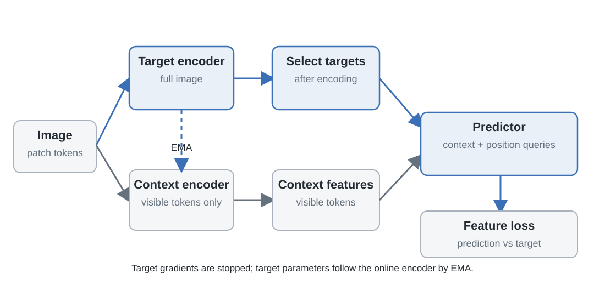
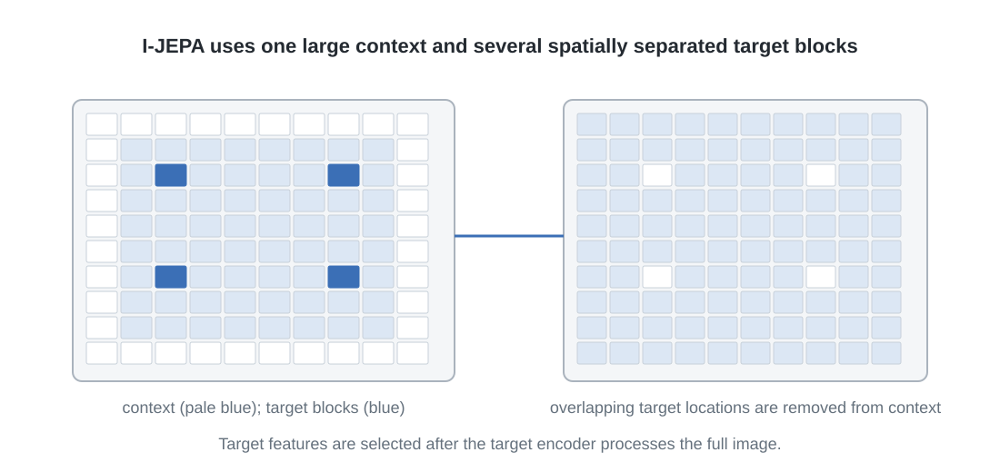

# 3. I-JEPA: predicting hidden image features from spatial context

I-JEPA makes joint-embedding prediction concrete without introducing time, actions or a planner. An image is divided into patch tokens. The model receives a large region as context and predicts features at several other regions. The target is not an RGB crop. It is the output of a target encoder at selected spatial positions.

The distinction matters: the target encoder is not simply applied to an isolated hidden crop. It processes the image, produces a spatial feature map, and the method selects features at the target positions. The context encoder, by contrast, receives only visible context tokens. One branch constructs target features with access to the image; the other must infer those features from restricted context. (Assran et al., 2023)

## 3.1 From an image to a grid of features

Let an image be \(x\in\mathbb R^{H\times W\times 3}\). A patch embedding operation partitions it into a grid and maps each patch to a vector. For patch size \(P\times P\), the grid contains

\[
N_h=H/P,\qquad N_w=W/P,\qquad N=N_hN_w
\]

positions, assuming divisibility. The patch embedding produces tokens

\[
e(x)=(e_1,\ldots,e_N),\qquad e_i\in\mathbb R^d.
\]

Positional encodings identify where each token came from. A context encoder transforms selected visible tokens. A target encoder transforms the full image. If \(C\) is the context-position set and \(Y\) the target-position set, write

\[
Z_C=f_\theta(e(x)_C,C),\qquad
H_Y=f_{\bar\theta}(e(x))_Y.
\]

The subscript \(Y\) means that target features are selected from the target encoder's output at those positions. It does not mean that the target encoder only saw the target crop. The feature at a target position may incorporate information from a larger spatial neighbourhood through the target encoder.

The predictor is trained to estimate those contextualized target features from the restricted context pathway. This is a conditional feature-estimation problem, not patchwise pixel completion.

## 3.2 The target is selected in feature space

A mask is sampled over the patch grid. One large context block determines which tokens are visible to the context encoder. Several smaller target blocks determine which target positions must be predicted. The target encoder still processes the image; the target mask selects which of its features contribute to the loss.

The default I-JEPA recipe uses one large context block and four target blocks. The context block is sampled with a large area, typically 85% to 100% of the image area. Each target block is sampled at a smaller scale, typically 15% to 20%, with a range of aspect ratios. Context positions that overlap target positions are removed from the context set. These values describe this implementation, not a universal definition of JEPA.

Why use multiple target blocks? A single target may encourage a narrow completion strategy. Several spatially separated targets require the context representation to support predictions at several locations. The predictor must use the visible image as a whole rather than only extrapolate one local boundary. Still, no mask geometry is universally best. A target adjacent to visible context may be predictable from local continuity; a distant target may require broader scene information.

The mask is part of the objective because it specifies what is unknown. It is not a neutral augmentation that can be changed without changing the conditional distribution faced by the predictor.

## 3.3 The predictor receives a location query

The context encoder produces features for visible tokens. The predictor must estimate features at target positions, but those positions are not visible as image tokens. I-JEPA supplies them as queries.

For each target block, the predictor receives context features together with learned mask tokens. A positional embedding is added to each mask token to indicate its target location. The predictor processes the visible context and target queries jointly and outputs a vector at each requested position:

\[
\widehat H_{Y_m}
=
g_\phi(Z_C,\operatorname{pos}(Y_m)).
\]

The learned mask token provides a common starting vector for a missing position. The positional embedding distinguishes one requested location from another. Without the position, identical mask tokens would not tell the predictor which target feature it is being asked to estimate.

The predictor does not generate an image patch. It outputs a feature vector in the target encoder's representation space. The target position specifies *where* a representation is requested; the context specifies *what information is available* to estimate it.

The target blocks are prediction queries. A useful diagram should show one context pathway feeding several position-marked query sets, rather than depicting the method as a single crop-to-crop translation.

## 3.4 The training objective

Let \(Y_1,\ldots,Y_M\) denote the sampled target blocks, with \(M=4\) in the default recipe. Let \(H_{Y_m}\) be target features and \(\widehat H_{Y_m}\) their predictions. The paper defines the loss as the average discrepancy over target blocks:

\[
\mathcal L_{\mathrm{I\text{-}JEPA}}
=
\frac{1}{M}
\sum_{m=1}^{M}
D(\widehat H_{Y_m},H_{Y_m})
=
\frac{1}{M}
\sum_{m=1}^{M}
\sum_{j\in Y_m}
\|\widehat h_j-h_j\|_2^2.
\]

Here \(D\) is the sum of squared Euclidean discrepancies over the target tokens in one block. The outer average gives equal weight to the sampled target blocks. Within each block, the displayed paper equation sums over target positions; it does not show an additional division by the number of positions or feature dimensions. This matters when comparing numerical loss magnitudes across implementations, because sum-versus-mean reductions change the scale of the objective even if they use identical predictions and targets. (Assran et al., 2023)

There is no pixel-level reconstruction term. A prediction is correct when it matches the target encoder's feature, even if no RGB patch is produced. The target encoder therefore determines which visual differences matter. If its features are insensitive to illumination, predicting the target does not require reproducing illumination changes. If the target features retain object boundaries or spatial arrangement, those properties remain visible to the loss.

This does not mean that the model automatically learns semantic information or discards every unpredictable detail. It means only that the error is evaluated in a learned feature space. The contents and invariances of that space must be measured.

## 3.5 Why use a target encoder?

The target features should not move in exactly the same way as the predictor's output during the same gradient update. If both sides of a feature-matching objective are updated freely, they can reduce their discrepancy by changing together, including toward a constant representation. I-JEPA uses a slowly moving target encoder to provide a more stable regression target.

The context encoder and predictor are updated by gradient descent. The target encoder is updated by an exponential moving average:

\[
\bar\theta_{t+1}
=
m_t\bar\theta_t+(1-m_t)\theta_{t+1}.
\]

For fixed \(m\), repeated substitution gives

\[
\bar\theta_t
=
m^t\bar\theta_0
+
(1-m)\sum_{k=0}^{t-1}m^k\theta_{t-k}.
\]

The target parameters are a smoothed history of the online parameters. This reduces how quickly the regression target changes as the online encoder is optimized.

Three operations must be kept distinct:

- **Stop-gradient** blocks a derivative along a particular computational path.
- **EMA** updates target parameters using a weighted history of online parameters.
- **Prediction loss** compares predicted and target features.

They work together in I-JEPA but are not synonyms. EMA is part of this method's recipe, not a universal requirement for all JEPAs, and not a theorem that collapse is impossible under every implementation.

## 3.6 The mask and target encoder jointly specify the task

The context mask controls what the predictor can observe. It sets the visible fraction, distance between visible and withheld regions, number of target blocks and their sizes. The target encoder controls what must be predicted at those positions. Two methods can use the same mask and differ because their target representations preserve different features. Conversely, two methods can share a target encoder and learn different relations because their masks sample different conditional problems.

Consider an image of a table with several objects. A nearby target block may be predictable from texture continuity. A target containing another object may require information about the broader scene. A target containing a small object near a boundary may require spatial precision that a global pooled representation would not preserve. I-JEPA does not guarantee that one of these properties will be learned. It creates a training signal in which the predictor estimates target features for sampled regions.

The target-block distribution should therefore be read as part of the model specification. The architecture is not only a pair of encoders and a predictor. It also includes a rule for deciding which information is visible and which target locations are queried.

## 3.7 What the experiments establish

The I-JEPA paper evaluates representations through downstream protocols including image classification, low-shot classification, object counting and depth estimation. These experiments test whether features learned from spatial prediction are useful beyond the pretraining loss. They are not measurements of future-state prediction or action-conditioned dynamics.

The paper also compares target-mask designs. Its multi-block sampling performs better than alternatives such as rasterized, single-block or random masking in the reported low-shot ImageNet setting. The conclusion is not that four blocks are universally optimal. It is that target geometry materially affects what the objective teaches.

Evaluation protocol matters. A frozen encoder with a linear classifier tests which distinctions are accessible to a linear readout. A denser or task-specific head can extract different information. Neither is a direct test of whether the representation preserves every variable required for a physical transition model.

I-JEPA is a clean image-representation result and a demonstration of spatial feature prediction. It is not an action-conditioned world model. It receives no intervention as input, and its target is sampled from an image rather than a controlled future trajectory.

## 3.8 What I-JEPA does not tell us

**No time variable.** The target and context belong to one image. The method is not trained to distinguish motion histories or predict the result of a later action.

**No action variable.** The predictor receives spatial query positions, not a chosen control input. It cannot answer what would happen under different candidate actions unless an extension supplies an action condition.

**Target-relative information.** The predictor matches features that the target encoder emits. A feature not retained by that encoder is not directly supervised.

**No rollout requirement.** The method is optimized for masked feature prediction, not recursive application of its own predictions. Good masked-region performance does not establish long-horizon consistency.

**No planning objective.** The loss does not specify which future state is desirable, how candidate actions should be compared, or how safety constraints should be enforced.

These points delimit the problem I-JEPA was designed to solve; they are not defects in that paper. Video prediction adds time to the target. Action-conditioned models add the intervention that distinguishes one possible future from another.

**Figure 4.6. I-JEPA's two information paths.** The target encoder processes the full image before target features are selected; the context encoder processes visible tokens only. Position-marked queries specify where the predictor must return features.

**Figure 4.7. I-JEPA's context and target-block geometry.** A large context block and multiple target blocks define the spatial prediction problem. Target positions overlapping the sampled context are removed from the context input.

The next step is to add time. A video representation can be indexed by both spatial and temporal position, so the target sampler can ask the model to predict features withheld from a sequence rather than from one image.
