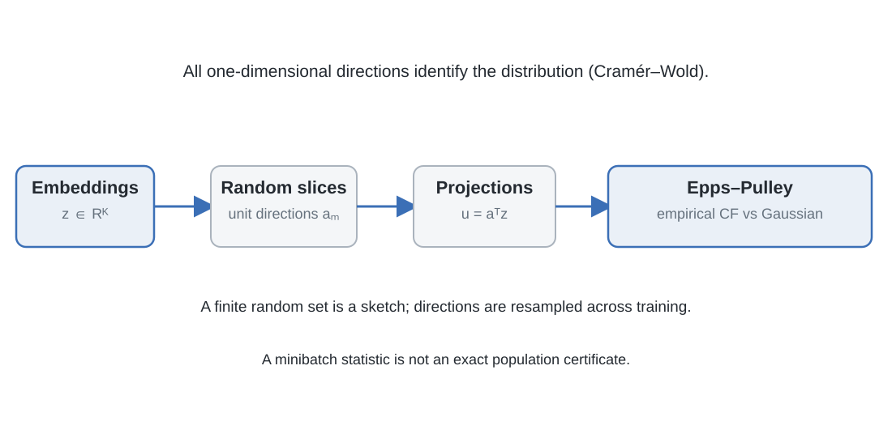
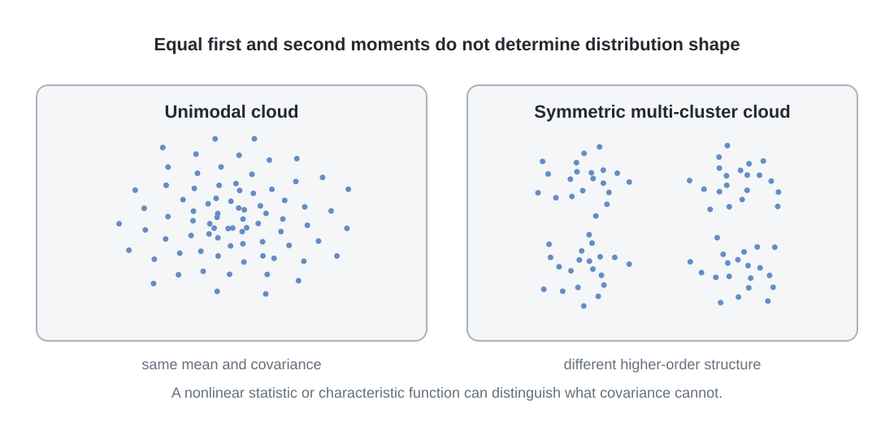
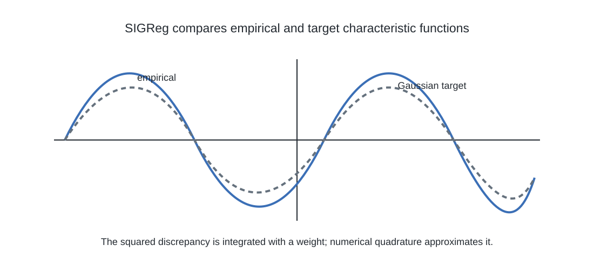

# 9. Distribution matching by projection: SIGReg

The previous section identified a target distribution through downstream prediction risk. Under the assumptions analysed there, the embedding distribution that minimizes the relevant risk criteria is an isotropic Gaussian. A training objective must now answer a computational question: how can a neural encoder be encouraged to match a high-dimensional distribution without estimating its density explicitly?

SIGReg, introduced in LeJEPA, replaces a multivariate goodness-of-fit problem with a collection of one-dimensional tests. The mathematical link is the Cramér–Wold theorem. The practical statistic is based on empirical characteristic functions and the Epps–Pulley test.

## 9.1 Why moments do not define the distribution

Suppose two embedding distributions have the same mean and covariance. They need not have the same shape. In one dimension, a standard normal random variable and a variable taking values \(-1\) and \(+1\) with equal probability both have mean zero and variance one. Their characteristic functions differ:

\[
\varphi_{\mathrm{normal}}(t)=e^{-t^2/2},
\qquad
\varphi_{\mathrm{two\ point}}(t)=\cos(t).
\]

The first two moments therefore do not identify the distribution. Matching a finite number of additional moments still does not identify a general probability distribution. For a particular target family, moment constraints may be useful; they are not a general certificate of distributional equality.

This is the limitation of covariance-based regularization when the theoretical target is a Gaussian density. Covariance controls second-order structure. It does not control all higher-order shape.

## 9.2 The characteristic function

For a scalar random variable \(U\), its characteristic function is

\[
\varphi_U(t)=\mathbb E[e^{itU}],
\qquad t\in\mathbb R.
\]

The characteristic function exists for every probability distribution because the complex exponential has unit magnitude. It uniquely determines the distribution of \(U\).

For a standard normal random variable,

\[
\varphi_0(t)=e^{-t^2/2}.
\]

Given scalar samples \(u_1,\ldots,u_N\), the empirical characteristic function is

\[
\widehat\varphi_N(t)
=
\frac{1}{N}\sum_{n=1}^{N}e^{itu_n}.
\]

It is a finite average of complex exponentials. Unlike high-order moments, it does not require raising samples to increasingly large powers. It is differentiable with respect to each sample, and its sums can be aggregated across distributed workers. Its integrand is bounded, which avoids the polynomial growth that can make high-order moment objectives difficult to optimize.

A characteristic-function statistic still requires a frequency weighting and numerical integration. The choice of weight determines how discrepancies at different frequencies contribute to the result.

## 9.3 Cramér–Wold: why projections can identify a distribution

Let \(Z\in\mathbb R^K\) be an embedding vector and let \(a\in\mathbb S^{K-1}\) be a unit direction. The one-dimensional projection is

\[
U_a=a^\top Z.
\]

The Cramér–Wold theorem states that two probability distributions on \(\mathbb R^K\) are equal if and only if all their one-dimensional linear projections have the same distribution:

\[
a^\top X\overset{d}{=}a^\top Y
\quad\text{for every }a\in\mathbb S^{K-1}
\quad\Longleftrightarrow\quad
X\overset{d}{=}Y.
\]

For an isotropic Gaussian target,

\[
Z\sim\mathcal N(0,I_K)
\quad\Longrightarrow\quad
a^\top Z\sim\mathcal N(0,1)
\]

for every unit vector \(a\). A high-dimensional Gaussian-matching problem can therefore be examined through scalar normality tests along directions.

The all-directions qualification is essential. Matching a finite set of projections is not, in general, sufficient to identify an arbitrary multivariate distribution exactly. A finite set may miss a structured discrepancy that lies between sampled directions. Increasing the number and diversity of projections improves the sketch, but the finite training objective remains a stochastic approximation to the all-directions condition.

The practical advantage is that a scalar test can be evaluated without estimating a full \(K\)-dimensional density. The projection matrix is the computational bridge between the embedding batch and these one-dimensional statistics.

## 9.4 A directional statistical test

Let \(P_\theta\) denote the distribution of learned embeddings and \(Q=\mathcal N(0,I_K)\) the target. For a unit direction \(a\), the projected distributions are

\[
P_\theta^{(a)}=(a^\top)_\#P_\theta,
\qquad
Q^{(a)}=(a^\top)_\#Q.
\]

A one-dimensional goodness-of-fit statistic \(T\) compares samples from \(P_\theta^{(a)}\) with the standard-normal target. Repeating the comparison over a set of directions

\[
\mathcal A=\{a_1,\ldots,a_M\}
\]

produces directional evidence about the multivariate distribution.

The formal union-intersection test in LeJEPA aggregates directional statistics through a maximum:

\[
T_{\mathcal A}
=
\max_{a\in\mathcal A}
T\!\left(
\{a^\top z_n\}_{n=1}^{N}
\right).
\]

The maximum is natural for a statistical test: a sufficiently large discrepancy in any tested direction is evidence against the null. The training regularizer takes a different form. SIGReg averages the directional statistics:

\[
\mathcal L_{\mathrm{SIGReg}}
=
\frac{1}{M}
\sum_{m=1}^{M}
T\!\left(
\{a_m^\top z_n\}_{n=1}^{N}
\right).
\]

The average distributes gradient contributions across sampled directions. A maximum can concentrate the optimization signal on the current worst direction, leaving the other directions with no direct contribution at that step. The maximum and the average therefore serve different roles: the former is a test statistic, the latter a practical training objective. (Balestriero and LeCun, 2025)

## 9.5 The Epps–Pulley statistic

LeJEPA uses the Epps–Pulley test to compare empirical and target characteristic functions. For a projected sample \(u_1,\ldots,u_N\), define

\[
\widehat\varphi_N(t)
=
\frac{1}{N}\sum_{n=1}^{N}e^{itu_n}.
\]

The Epps–Pulley statistic is

\[
T_{\mathrm{EP}}
=
N\int_{-\infty}^{\infty}
\left|
\widehat\varphi_N(t)-\varphi_0(t)
\right|^2
w(t)\,dt,
\qquad
\varphi_0(t)=e^{-t^2/2}.
\]

The paper writes the frequency window as

\[
w(t)=e^{-t^2/\sigma^2}.
\]

Its displayed Algorithm 1 evaluates the integral on 17 points over \([-5,5]\), constructs the standard-normal characteristic function using \(\exp(-t^2/2)\), and uses that same sampled Gaussian vector to weight the squared empirical-to-target discrepancy. The mathematical roles remain distinct: the target characteristic function specifies the null distribution, while \(w(t)\) specifies frequency weighting. The paper's equation and algorithm should therefore be quoted at their respective levels rather than inferring a bandwidth setting that is not explicit in the implementation listing.

The statistic compares the empirical characteristic function with the target over a range of frequencies. It is not a mean-and-variance penalty. Deviations in the shape of the projected distribution can affect the characteristic function even when the first two moments match.

The implementation approximates the integral numerically. Its pseudocode samples 17 points on the interval \([-5,5]\), evaluates the Gaussian characteristic function \(e^{-t^2/2}\), multiplies the squared empirical-to-target discrepancy by that Gaussian vector, and applies trapezoidal quadrature. The paper notes that symmetry of the integrand can be used to double the effective number of knots without an equivalent increase in computation. This is an implementation prescription, not a mathematical requirement of the Epps–Pulley test. The paper's general test definition writes the Gaussian window as \(w(t)=e^{-t^2/\sigma^2}\), commonly with \(\sigma=1\); the displayed code uses \(e^{-t^2/2}\) as its numerical window. The equation and code should therefore be read in their own stated conventions rather than silently identifying their window parameterizations. (Balestriero and LeCun, 2025)

## 9.6 From one projection to a minibatch objective

For a batch of embeddings \(z_1,\ldots,z_N\), sample unit directions by drawing Gaussian vectors and normalizing them:

\[
a_m=\frac{g_m}{\|g_m\|_2},
\qquad
g_m\sim\mathcal N(0,I_K).
\]

For each direction, project every embedding:

\[
u_{n,m}=a_m^\top z_n.
\]

Compute the one-dimensional Epps–Pulley statistic for the \(N\) projected samples, then average over directions:

\[
\mathcal L_{\mathrm{SIGReg}}(Z)
=
\frac{1}{M}\sum_{m=1}^{M}
T_{\mathrm{EP}}(u_{1,m},\ldots,u_{N,m}).
\]

The directions are resampled during training. The reference implementation seeds the direction sampler from the global training step so that distributed workers use synchronized projections. Each minibatch therefore sees a new sketch of the same embedding distribution. The cumulative number of directions sampled over training can be much larger than the number evaluated in any one minibatch.

This resampling has an important consequence. A small number of directions in one step does not mean the model is constrained to those same directions throughout training. LeJEPA reports that resampling as few as 16 directions per minibatch can outperform optimizing against a fixed set containing thousands of directions, because the sampled directions accumulate over training. This is an empirical property of the optimization setup, not an exact finite-step Cramér–Wold guarantee. (Balestriero and LeCun, 2025)

The projection and characteristic-function operations can be written as matrix multiplication followed by complex-exponential evaluations and numerical integration. With the embedding dimension, number of slices and number of quadrature points fixed, the reference implementation is linear in minibatch size \(N\). More generally, the work depends on \(N\), embedding dimension \(K\), number of directions \(M\), and number of integration points. The paper's \(\mathcal O(N)\) statement refers to scaling in batch size for fixed sketch parameters; it should not be read as independence from projection count or feature dimension.

For distributed training, each worker computes local sums of complex exponentials and combines them with an all-reduce operation. This makes the empirical characteristic function compatible with data-parallel training without gathering all projected samples on one device.

## 9.7 Stability and finite-batch effects

The empirical characteristic function is an average of bounded complex values. The Epps–Pulley construction therefore avoids the polynomial growth of high-order moments. LeJEPA derives bounds on the statistic's gradient and curvature with respect to projected samples. By the chain rule, this supplies a controlled contribution to the encoder gradient for the statistic under analysis.

This is a statement about the Epps–Pulley statistic and its inputs. It does not imply that the gradient of the complete neural network objective is bounded independently of the network architecture, parameterization or all optimization details.

A finite minibatch also introduces bias in the statistic and its gradient. The paper derives an \(\mathcal O(1/N)\) term and reports that it is small in the tested settings, including minibatches as small as 16. U-statistic debiasing or sample splitting could provide unbiased alternatives, but those are not part of the reference training procedure. The training loss is thus a finite-sample estimate, not an exact population test. (Balestriero and LeCun, 2025)

There is a related statistical caution. In classical hypothesis testing, failing to reject a null hypothesis does not prove that the null is true. It says only that the observed sample did not supply sufficient evidence against it at the selected test level. Training minimizes a regularizer rather than making a one-shot accept/reject decision, but the logical distinction remains: a small finite-sample projection statistic is evidence of approximate matching under the sampled directions and frequencies, not a certificate of exact population Gaussianity.

## 9.8 Embedding SIGReg inside a predictive objective

SIGReg specifies a distributional constraint. It does not replace the task that tells the encoder which views should be related. LeJEPA combines the two.

For each observation, let \(z_{n,v}\) be the embedding of view \(v\). Let the first \(V_g\) views be global views, and define their mean

\[
\mu_n
=
\frac{1}{V_g}\sum_{v=1}^{V_g}z_{n,v}.
\]

A view-agreement term draws every view embedding toward this global-view centre:

\[
\mathcal L_{\mathrm{pred}}
=
\frac{1}{NV}
\sum_{n=1}^{N}
\sum_{v=1}^{V}
\|\mu_n-z_{n,v}\|_2^2.
\]

SIGReg is applied to the embedding distribution of the views. The total objective is

\[
\mathcal L_{\mathrm{LeJEPA}}
=
(1-\alpha)\mathcal L_{\mathrm{pred}}
+
\alpha\mathcal L_{\mathrm{SIGReg}},
\]

where \(\alpha\) is the single trade-off parameter between view agreement and distribution matching.

This construction differs from an EMA teacher-predictor system. In the base LeJEPA recipe, the mean of the global-view embeddings provides the centre toward which all views are drawn. The method does not require an EMA target encoder, a stop-gradient target branch or a separate predictor network. SIGReg is applied separately to the batch of embeddings from each view and then averaged over the \(V\) views. The complete objective can therefore be written as

\[
\mathcal L_{\mathrm{LeJEPA}}
=
(1-\alpha)\mathcal L_{\mathrm{pred}}
+
\frac{\alpha}{V}
\sum_{v=1}^{V}
\operatorname{SIGReg}
\left(
\{z_{n,v}\}_{n=1}^{N}
\right).
\]

Here \(\mathcal L_{\mathrm{pred}}\) averages the squared distance between every view and the per-sample mean of the global-view embeddings. The outer coefficient \(\alpha\) is the single trade-off hyperparameter in the method's stated objective. SIGReg does not regularize one pooled collection formed by mixing all views into a single batch; each view distribution is tested separately. This distinction is relevant because crop scales and augmentation distributions can differ between global and local views. (Balestriero and LeCun, 2025)

## 9.9 What SIGReg makes possible

The logical contribution of SIGReg is a practical route from a high-dimensional distributional target to differentiable one-dimensional tests:

1. A downstream-risk analysis motivates a target distribution.
2. Cramér–Wold shows that all one-dimensional projections identify the multivariate distribution.
3. Random unit directions produce a stochastic sketch of those projections.
4. The empirical characteristic function represents each projected distribution.
5. Epps–Pulley measures its discrepancy from the Gaussian target.
6. Numerical quadrature and batch aggregation make the statistic usable in gradient-based training.

Each step introduces an approximation or assumption. The Gaussian target is justified by the risk analysis, not by Cramér–Wold. Cramér–Wold is an all-directions result, not a finite-sample guarantee. Random projections reduce computation but do not remove the need to examine the number of directions and batch size. Epps–Pulley provides a stable statistic for the projected distributions, but the numerical integral is still approximated.

SIGReg therefore controls more than the first two moments, but it does so by sampling and testing one-dimensional views of the embedding distribution. The next section considers a different decomposition of the same distributional problem: control the centre and scale explicitly, then compare shape after the scale has been removed.

**Figure 4.17. All directions identify a distribution; sampled directions form a sketch.** Cramér–Wold characterizes a distribution through all one-dimensional projections. SIGReg uses sampled directions in each minibatch and accumulates coverage across training.

**Figure 4.18. Matching the first two moments does not fix distribution shape.** Two distributions can share a mean and covariance yet have different shapes. A projected characteristic function can reveal differences that covariance alone cannot detect.

**Figure 4.19. The Epps–Pulley statistic compares characteristic functions.** SIGReg compares empirical and Gaussian characteristic functions across frequency and integrates the squared discrepancy with a weight. A finite quadrature grid approximates the integral.

