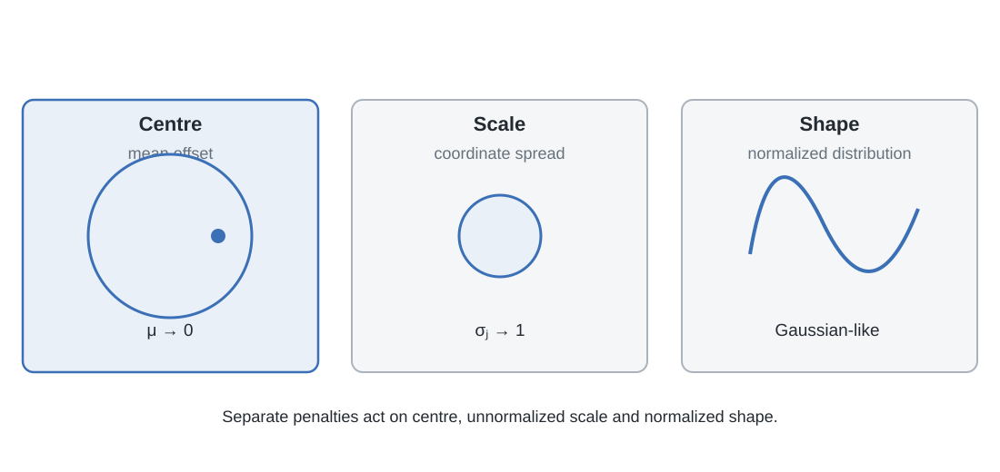
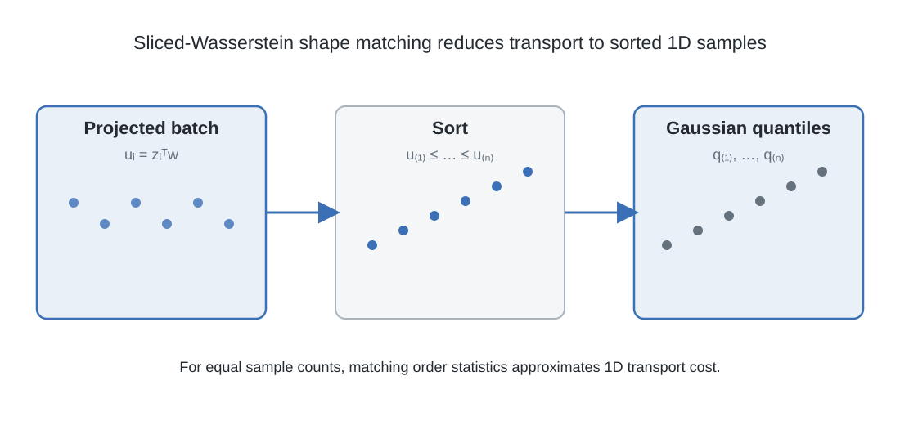
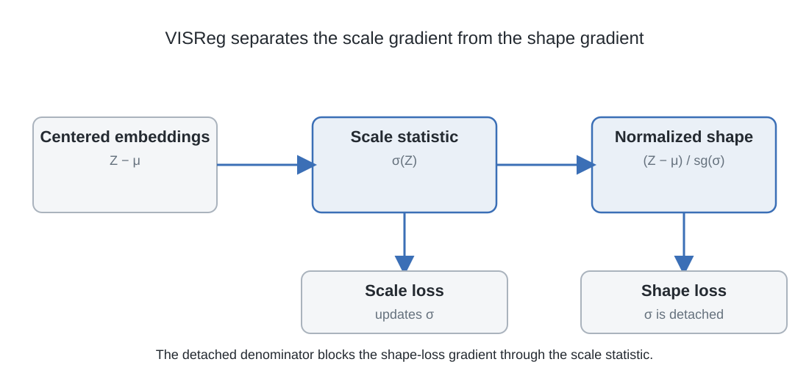

# 10. Separating scale and shape: VISReg

SIGReg compares projected distributions with a Gaussian target through characteristic functions. VISReg addresses the same distributional problem with a different decomposition. It separates the scale of the embedding coordinates from the shape of the normalized batch, and it allows the three regularization components to be reweighted independently.

The purpose of this construction is not merely to add another anti-collapse penalty. It gives the optimizer two distinct jobs: maintain usable coordinate scale, and shape the normalized embedding distribution toward an isotropic Gaussian.

## 10.1 Three different properties of a batch

Let the embeddings of a batch be \(Z\in\mathbb R^{N\times D}\), with \(N\) samples and \(D\) feature dimensions. Define the batch mean and centered embeddings:

\[
\mu=\frac{1}{N}\sum_{n=1}^{N}z_n,
\qquad
\widehat Z=Z-\mu.
\]

Three distinct properties can now be considered.

**Centre.** Is the embedding cloud centred at the origin? A nonzero mean shifts every projection, even if the covariance and higher-order shape are otherwise acceptable.

**Scale.** How much variation does each coordinate have? If a representation contracts toward the origin, its standard deviations become small. If some coordinates expand excessively, they can dominate the embedding geometry.

**Shape.** After the mean and scale are accounted for, does the distribution resemble the desired shape? A batch can have unit coordinate-wise variance and identity covariance while remaining non-Gaussian.

These properties should not be treated as one statistic. A variance term does not identify the full distribution. A distributional shape test that normalizes away scale does not, by itself, require the unnormalized embedding cloud to have unit variance.

## 10.2 The scale term

Let \(\sigma_j(\widehat Z)\) denote the batch standard deviation of coordinate \(j\). VISReg uses the scale objective

\[
\mathcal L_{\mathrm{scale}}
=
\frac{1}{D}
\sum_{j=1}^{D}
\left(1-\sigma_j(\widehat Z)\right)^2.
\]

The target standard deviation is one in each coordinate. The term penalizes both contraction below unit scale and expansion above it. Its minimum is attained when every coordinate has unit batch standard deviation.

The scalar derivative for coordinate \(j\) is

\[
\frac{\partial\mathcal L_{\mathrm{scale}}}
{\partial\sigma_j}
=
-\frac{2}{D}(1-\sigma_j).
\]

At zero standard deviation, this derivative remains finite and nonzero. The paper contrasts this scale signal with SIGReg's characteristic-function gradient near collapsed embeddings, which diminishes in the collapse regime. The authors report controlled gradient comparisons in which the VISReg scale term supplies a corrective signal under the tested setup. This is not a universal lower bound on every encoder-parameter gradient: the chain rule through the batch standard deviation and the network still depends on the representation, architecture and numerical implementation. (Wu et al., 2026)

## 10.3 Removing scale from the shape comparison

VISReg normalizes the centered batch coordinate-wise:

\[
\widetilde Z
=
\frac{\widehat Z}
{\operatorname{sg}(\sigma(\widehat Z))+\epsilon},
\]

where \(\epsilon>0\) stabilizes the denominator and \(\operatorname{sg}\) denotes stop-gradient.

The normalization removes coordinate scale before the shape comparison. The stop-gradient means that the shape term does not differentiate through the standard-deviation denominator. The scale objective remains the direct mechanism for adjusting the unnormalized coordinate spread, while the shape statistic compares normalized samples.

This gradient boundary is not the same as an EMA target update. An EMA makes a target encoder follow the online encoder slowly. Here, stop-gradient is applied to the scale statistic used in normalization. It changes which derivatives the shape objective contributes. The two mechanisms should not be described as the same kind of teacher-student asymmetry.

The normalization also does not imply that the scale and shape objectives are interchangeable. The scale term acts on the unnormalized centered coordinates. The shape term acts on the normalized batch. Their separate coefficients allow the training objective to assign different importance to the two requirements.

## 10.4 Sliced Wasserstein distance

The shape term compares projected normalized embeddings with projections of a standard Gaussian. The one-dimensional sorting operation is piecewise differentiable with respect to the projected values except at ties, where the ordering changes; the loss does not require a differentiable relaxation of a high-dimensional sorting operation. For a unit direction \(w_k\in\mathbb S^{D-1}\), form the scalar samples

\[
u_k=\widetilde Z w_k\in\mathbb R^N.
\]

Let \(u_{k,(1)}\le\cdots\le u_{k,(N)}\) denote the sorted projected values. Define the standard-normal reference quantiles by

\[
r_i=\frac{i}{N+1},
\qquad
q_i=\Phi^{-1}(r_i),
\qquad i=1,\ldots,N,
\]

where \(\Phi\) is the standard-normal cumulative distribution function.

For two equally weighted empirical distributions on the real line with the same number of samples, the optimal quadratic transport coupling matches their order statistics. Thus

\[
W_2^2(\widehat P,\widehat Q)
=
\frac{1}{N}
\sum_{i=1}^{N}
\left(u_{(i)}-q_i\right)^2.
\]

The factor \(1/N\) is part of the empirical one-dimensional Wasserstein distance. The paper's displayed shape objective is

\[
\mathcal L_{\mathrm{shape}}
=
\frac{1}{K_s}
\sum_{k=1}^{K_s}
\left\|
\operatorname{sort}(\widetilde Z w_k)-q
\right\|_2^2,
\]

where \(K_s\) is the number of slices. The accompanying Algorithm 1, however, computes `(p_sorted - target).pow(2).mean()`, which averages over both the \(N\) samples and the \(K_s\) slices. The code therefore includes a factor \(1/N\) relative to the displayed squared-norm expression. This is a normalization discrepancy between the printed objective and the pseudocode, not a difference in the intended transport coupling. It changes the numerical scale of the regularizer with batch size and must be resolved against the exact implementation when reproducing loss weights or comparing reported coefficients.

The paper's normalization equation also shows an \(\epsilon\) in the denominator, whereas the printed algorithm excerpt divides by the detached standard deviation directly. Implementations should use the stabilizer appropriate to the precision and numerical regime, and document that choice. The conceptual construction is unchanged: standardize each coordinate using a detached scale statistic, then compare the sorted one-dimensional projections with Gaussian quantiles.

The difference between SIGReg and VISReg lies in the one-dimensional statistic. SIGReg compares empirical characteristic functions with the target characteristic function. VISReg sorts projected samples and compares their empirical quantiles with Gaussian quantiles. Both use random projections, but they do not compute the same discrepancy. (Wu et al., 2026)

## 10.5 Centre, scale and shape in one objective

The centering term is

\[
\mathcal L_{\mathrm{center}}=\|\mu\|_2^2.
\]

VISReg assigns separate weights to its three regularization components:

\[
\mathcal L_{\mathrm{reg}}
=
\lambda_{\mathrm{scale}}\mathcal L_{\mathrm{scale}}
+
\lambda_{\mathrm{shape}}\mathcal L_{\mathrm{shape}}
+
\lambda_{\mathrm{center}}\mathcal L_{\mathrm{center}}.
\]

The method also retains a view-agreement signal. Let \(z_{n,v}\) denote the embedding of sample \(n\) in view \(v\), with \(V_g\) global views among \(V\) total views. Define the centre of the global-view embeddings as

\[
\mu_{g,n}
=
\frac{1}{V_g}
\sum_{v=1}^{V_g}z_{n,v}.
\]

A view-invariance term draws each view embedding toward that global-view mean:

\[
\mathcal L_{\mathrm{pred}}
=
\frac{1}{NV}
\sum_{n=1}^{N}
\sum_{v=1}^{V}
\|\mu_{g,n}-z_{n,v}\|_2^2.
\]

The complete loss is

\[
\mathcal L_{\mathrm{VISReg}}
=
(1-\lambda)\mathcal L_{\mathrm{pred}}
+
\lambda\mathcal L_{\mathrm{reg}}.
\]

There are therefore four loss weights in the formulation: the outer \(\lambda\), and the three component weights inside \(\mathcal L_{\mathrm{reg}}\). The default component weights are one in the stated baseline; the authors ablate and reweight them, finding that increasing the shape weight can help on low-quality datasets. They also report different useful outer \(\lambda\) values for small and large datasets. These are optimization choices, not new terms in the objective. (Wu et al., 2026)

## 10.6 Computational scaling and distributed slices

The regularization computation projects the \(N\times D\) batch onto \(K_s\) random directions and sorts the \(N\) scalar values in each slice. Its two dominant operations are

\[
O(NDK_s)+O(K_sN\log N).
\]

Because \(\log N\ll D\) at the scales considered, the paper treats the effective regularization complexity as \(O(NDK_s)\). This is linear in batch size, embedding dimension and number of slices when those are treated as separate scaling parameters.

The number of slices needed for a good approximation can, however, grow with embedding dimension. The authors show empirically that a single-GPU setting often needs \(K_s=C D\) for some factor \(C>1\), which makes the effective projection cost approximately \(O(CND^2)\). They address this by generating independent slices across GPUs. With \(M\) devices, each device can process a fraction of the total slice set, and the partial losses can be aggregated. Their experiments show that increasing the number of devices can compensate for a smaller number of slices per device. The paper therefore argues that \(K_s\) can remain fixed per device while scaling the training setup. This is an empirical scaling strategy, not a theorem that a fixed finite set of directions identifies every distribution. (Wu et al., 2026)

## 10.7 What the experiments support

VISReg evaluates its regularizer through ablations, low-quality and long-tailed data, low-rank data, linear evaluation, transfer learning, out-of-distribution performance, dense prediction and image-generation guidance. The paper reports that the shape weight can be increased for low-quality datasets, that VISReg remains comparatively robust at lower slice counts, and that distributing slices across multiple GPUs can compensate for an insufficient per-device projection count.

For downstream evaluation, the authors report that an ImageNet-22K-pretrained VISReg ViT-L/14 reaches an average score of 72.94 across their selected downstream datasets, compared with 72.93 for DINOv2-LVD142M in the reported table. This is a matched aggregate on the listed benchmarks, not evidence that the two methods are equivalent on every task. The paper also reports competitive OOD performance from ImageNet-1K pretraining and strong robustness in long-tailed and low-rank settings. (Wu et al., 2026)

These experiments support the proposed decomposition under the paper's architectures, data and optimization settings. They are not a theorem that every parameterization recovers from every collapsed initialization. A controlled gradient comparison does not prove that every network can recover from every degenerate state. An OOD score on a particular benchmark set does not establish universal superiority or task sufficiency.

## 10.8 The broader design principle

The sequence from covariance penalties to SIGReg and VISReg is not simply a progression of increasingly elaborate anti-collapse tricks.

A variance floor constrains marginal spread. A covariance penalty constrains pairwise linear redundancy. SIGReg compares projected characteristic functions with a Gaussian target. VISReg separates the correction of centre and scale from a sliced-Wasserstein shape comparison. Each objective introduces a different statistical condition.

None of these conditions, in isolation, proves that the representation is sufficient for a physical task. The Gaussian target is motivated by the downstream-risk analysis already developed. The practical objectives approximate distributional constraints on the representation. A separate predictive target is still needed to specify what the representation should preserve.

This distinction becomes decisive when the model is used for interaction. The next section turns from the geometry of passive observations to the information needed to predict the consequences of chosen actions.

**Figure 4.20. VISReg separates centre, scale and shape.** VISReg regularizes mean offset, coordinate scale and normalized distribution shape with distinct terms. These components constrain different properties of the embedding batch.

**Figure 4.21. Sliced-Wasserstein matching is one-dimensional sorting.** After projection, empirical samples and Gaussian reference quantiles are sorted and corresponding order statistics are matched. Repeating this operation across directions approximates sliced transport.

**Figure 4.22. Stop-gradient separates scale correction from shape normalization.** The scale term acts on the unnormalized centered batch, while the shape loss treats the standard-deviation denominator as constant. This separates gradient paths without an EMA target.