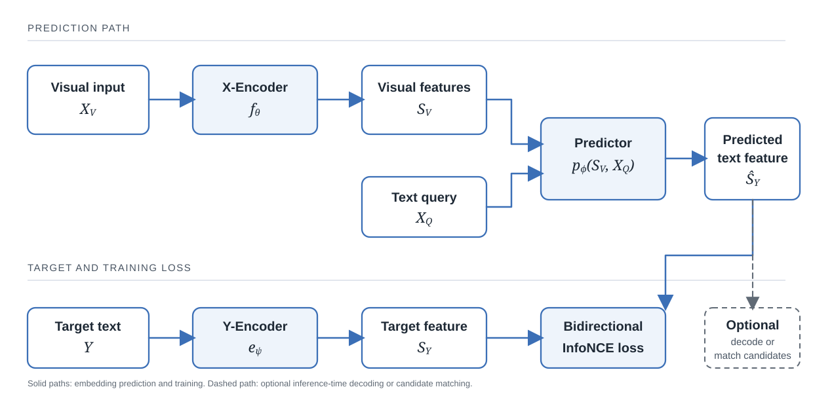

# 11. Cross-modal prediction: when the target is language

The image and video examples establish that a predictor can be trained to infer a hidden representation rather than reconstruct the observation itself. They do not establish that the target representation must belong to the same modality as the input. VL-JEPA makes this distinction explicit. Its visual input is an image or video, but its prediction target is a text embedding. A language query specifies which aspect of the visual evidence should be expressed.

This extension clarifies the generality of prediction in representation space. It does not, by itself, make a vision-language model a model of physical dynamics.

## 11.1 The visual context, query and target are different variables

Let \(X_V\) denote the visual input, \(X_Q\) a text query, and \(Y\) the target text. The query is not the target. It specifies the question being asked; the target is the answer representation against which the prediction is trained.

A minimal mathematical description is

\[
S_V=f_\theta\(X_V\),\qquad
S_Y=e_\psi\(Y\),\qquad
\widehat S_Y=p_\phi(S_V,X_Q).
\]

The visual encoder \(f_\theta\) converts an image or video into visual features. The target encoder \(e_\psi\) maps the answer text to a continuous representation. The predictor \(p_\phi\) combines the visual features with the query and estimates a vector in the target encoder's space.

Consider a video showing a person reaching toward a wall. One query asks which object the person is about to touch; another asks what action the person is performing. The frames are identical, but the requested answer changes. The query therefore selects the conditional prediction problem.

This separation is useful because a visual sequence does not determine one universally appropriate description. Captioning, object identification, question answering and retrieval impose different output requirements. A query-conditioned predictor can share visual features across them rather than treating each question as a new perception problem.

## 11.2 Why predict a text embedding?

A token-generative model produces a sequence of discrete symbols. An embedding-predictive model instead maps the target text through an encoder and learns to estimate the resulting vector. The difference is in the object being predicted and the geometry in which errors are measured.

For normalized predicted and target embeddings (ar{hat s}_i) and (ar s_i), a one-direction batch contrastive objective can be written as

\[
\mathcal L_{\widehat S\rightarrow S}
=
-\frac{1}{B}\sum_{i=1}^{B}
\log
\frac{
\exp(\bar{\hat s}_i^\top\bar s_i/\tau)
}{
\sum_{j=1}^{B}
\exp(\bar{\hat s}_i^\top\bar s_j/\tau)
},
\]

where \(B\) is the batch size and (	au) is a temperature. The reverse direction exchanges predicted and target embeddings. VL-JEPA averages the two directions, combining an alignment signal for paired examples with a uniformity pressure that discourages all examples from occupying the same representation.

The loss is important to identify correctly. VL-JEPA uses bidirectional InfoNCE in the reported formulation. It does not use SIGReg as its regularizer. The paper discusses non-sample-contrastive alternatives, including VICReg and SIGReg, as possibilities for future investigation rather than as part of its method (Chen et al., 2026).

An embedding target can place semantically related descriptions near one another even when their token sequences differ. For example, "the light turns off" and "the room becomes dark" may be represented as related descriptions of the same event. Whether they are close is determined by the text encoder and its training, not by the fact that the outputs are vectors. The same geometry can be harmful when two answers differ in a small but consequential detail. Embedding prediction changes the target space; it does not make the target encoder a neutral or universally sufficient representation.

## 11.3 Prediction and decoding are separate operations

The text decoder is not required for the main embedding-prediction loss. It is used when the system must turn a predicted vector into human-readable language. Other tasks can consume the embedding directly.

For retrieval, the predicted feature can be compared with embeddings of candidate texts. For classification, candidate label descriptions can be encoded and ranked against it. Neither operation requires generating a sentence token by token. Captioning and open-ended question answering do require readable language, so a decoder is needed for those outputs.

The published VL-JEPA instantiation uses a frozen V-JEPA 2 ViT-L visual encoder. Its predictor is initialized from Transformer layers of Llama 3.2, while the target text encoder is initialized from EmbeddingGemma. Projection heads map predicted and target features into a shared 1,536-dimensional space. Visual tokens and query tokens are jointly attended by the predictor. These are implementation choices in the paper, not defining requirements of cross-modal prediction (Chen et al., 2026).

Training is staged. An initial large-scale phase learns visual-text alignment from image-text and video-text pairs without task queries. A second, query-conditioned supervised fine-tuning phase introduces tasks such as visual question answering while retaining the pretrained alignment used for classification and retrieval. The two phases expose the model to different query distributions and should not be conflated (Chen et al., 2026).

The embedding/decoder separation also permits selective decoding. A system can update a stream of semantic embeddings as video frames arrive and invoke the text decoder only when the representation changes enough to warrant a new description. On the paper's EgoExo4D evaluation, selective decoding at 0.35 Hz matched the reported performance of uniform decoding at 1 Hz, using approximately 2.85 times fewer decoding operations. This is a result for that protocol, not a general latency guarantee (Chen et al., 2026).

**Figure 4.23. Cross-modal prediction separates the query from the target.** The predictor combines visual features with a text query to estimate a target-text embedding. During training, that estimate is compared with the encoded target; at inference, decoding is optional when an embedding-level decision is sufficient.

> **Description.** The visual pathway supplies image or video features, while a separate text query specifies the requested semantic output. A target-text encoder supplies the training representation. The predicted feature can be decoded when readable language is required, but the decoder is not part of the embedding prediction itself.

## 11.4 A language query is not a physical action

VL-JEPA evaluates semantic tasks that include action anticipation and next-step forecasting. Their outputs are descriptions or labels inferred from video context. These evaluations show that a visual representation can support useful predictions about likely events or human actions (Chen et al., 2026). They do not establish that the model can compare candidate robot commands or predict the physical consequences of a selected control.

The distinction can be expressed by comparing the two conditional computations:

\[
\widehat S_Y=p_\phi(f_\theta\(X_V\),X_Q),
\qquad
\widehat S_{t+1}=F_\omega(S_t,A_t).
\]

The first predicts a language-derived representation from visual evidence and a query. The second predicts a future state under a specified action. A prompt such as "What would happen if the switch were pushed?" asks for a hypothetical semantic answer, but the presence of hypothetical wording does not establish an intervention model. That requires action-conditioned data, an explicit control interface, appropriate action coverage, and evaluation of predicted state changes.

The target need not share the input modality. The conditioning variable, however, must still represent the quantity whose effect the model is meant to estimate. This is the boundary between cross-modal prediction and controlled dynamics. The next section examines the separate data and training requirements that arise when actions become explicit inputs to a world model.

